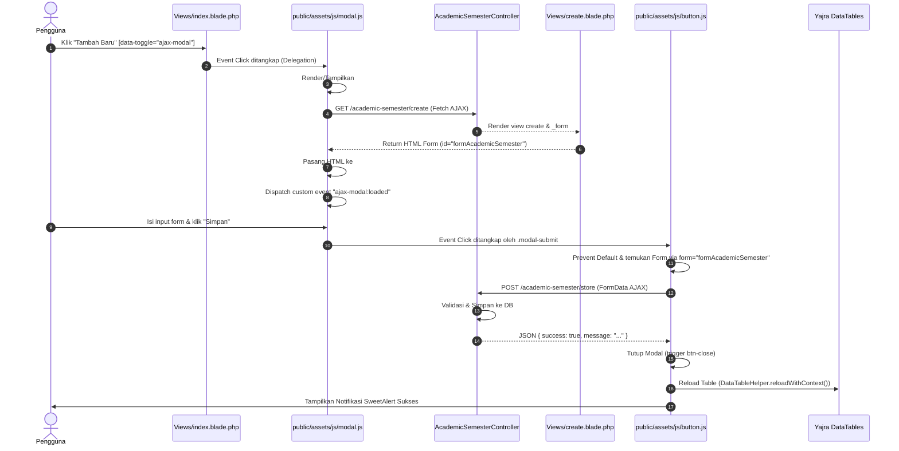

# Dokumentasi Implementasi AJAX Modal & Form Submission

Panduan teknis alur kerja integrasi **Modal Bootstrap 5 Dinamis (`modal.js`)** dengan **Handler Tombol & AJAX Form (`button.js`)** pada modul aplikasi (contoh: `AcademicSemester`).

---

## 1. Ikhtisar Arsitektur

Sistem modal AJAX ini dirancang dengan pendekatan decoupled (terpisah) dan modular:
1. **Trigger Button (`index.blade.php`)**: Membawa metadata modal (URL form, ukuran, judul, dan markup tombol submit/batal) melalui atribut HTML `data-*`.
2. **Modal Generator (`public/assets/js/modal.js`)**: Menangkap klik trigger, merender kontainer modal Bootstrap 5 (`#dynamicModal`), memuat konten HTML dari controller via `fetch`, dan menyisipkan tombol aksi ke dalam modal footer.
3. **Form Provider (`create.blade.php` / `_form.blade.php`)**: Merender elemen `<form>` yang diberi atribut `id` unik yang terhubung dengan tombol submit di modal footer.
4. **Button & AJAX Handler (`public/assets/js/button.js`)**: Menangkap klik pada tombol submit di modal (`.modal-submit`), mengumpulkan data form menggunakan `FormData`, mengirimkan request via AJAX, menampilkan feedback SweetAlert, menutup modal, dan me-reload Yajra DataTables tanpa refresh halaman.



---

## 2. Rincian Implementasi Tiap Komponen

### A. Tombol Trigger di Halaman Index (`app/Modules/AcademicSemester/Views/index.blade.php`)

Tombol trigger diletakkan di header card halaman data:

```html
<button type="button" 
        class="btn btn-primary btn-sm" 
        data-toggle="ajax-modal" 
        data-size="lg" 
        data-method="GET"
        data-title="Tambah Data AcademicSemester Baru" 
        data-url="{{ route('academic_semester.create') }}"
        data-submit='<button class="btn btn-primary modal-submit" type="submit" form="formAcademicSemester">Simpan</button>'
        data-cancel='<button class="btn btn-secondary" type="button" data-bs-dismiss="modal">Batal</button>'>
    <i class="bi bi-plus-circle"></i> Tambah Baru
</button>
```

#### Penjelasan Atribut Trigger:
| Atribut | Tipe | Deskripsi |
| :--- | :--- | :--- |
| `data-toggle="ajax-modal"` | String | Penanda utama yang didengarkan oleh listener `modal.js`. |
| `data-size="lg"` | String | Ukuran modal Bootstrap 5 (`sm`, `lg`, `xl`). |
| `data-method="GET"` | String | HTTP method untuk mengambil konten form. |
| `data-title="..."` | String | Judul yang akan ditampilkan pada header modal (`#modalTitle`). |
| `data-url="..."` | URL | Endpoint controller yang merender form create/edit. |
| `data-submit="..."` | HTML | Markup tombol submit yang disisipkan ke `#modalFooter`. Wajib memiliki atribut `form="[ID_FORM]"` dan class `modal-submit`. |
| `data-cancel="..."` | HTML | Markup tombol batal dengan atribut `data-bs-dismiss="modal"`. |

---

### B. View Form (`app/Modules/AcademicSemester/Views/create.blade.php`)

Agar tombol di modal footer dapat mengirimkan form yang berada di modal body (HTML5 Form Association), atribut `id` pada form **wajib sama persis** dengan atribut `form="..."` pada tombol submit.

```blade
<div class="card">
    <div class="card-header">
        <h4 class="card-title mb-0">Tambah {{ say('Academic Semester') }}</h4>
    </div>
    <div class="card-body">
        {{ Form::open([
            'method' => 'POST', 
            'route' => ['academic_semester.store'], 
            'class' => 'form-horizontal', 
            'id' => 'formAcademicSemester', 
            'enctype' => 'multipart/form-data', 
            'autocomplete' => 'off'
        ]) }}
        @include('AcademicSemester::_form')
        {{ Form::close() }}
    </div>
</div>
```

> [!IMPORTANT]
> Jangan lupa menambahkan `'id' => 'formAcademicSemester'` pada `Form::open(...)` dan `Form::model(...)` di `edit.blade.php`.

---

### C. Mekanisme Modal (`public/assets/js/modal.js`)

`modal.js` bertugas menangkap klik pada `[data-toggle="ajax-modal"]`, membuka modal secara dinamis, dan menyisipkan tombol:

1. **Ekstraksi Opsi Tombol**:
   Fungsi `extractButtonOptions` mengekstrak `data-submit`, dan secara otomatis memastikan class `modal-submit` terpasang agar selalu ditangkap oleh listener `button.js`:
   ```javascript
   function extractButtonOptions(triggerEl) {
       const buttons = [];
       if (triggerEl.dataset.submit) {
           let submitBtn = triggerEl.dataset.submit;
           if (!submitBtn.includes('modal-submit')) {
               if (/class=["']/.test(submitBtn)) {
                   submitBtn = submitBtn.replace(/(class=["'][^"']*)/, '$1 modal-submit');
               } else {
                   submitBtn = submitBtn.replace('<button', '<button class="modal-submit"');
               }
           }
           buttons.push(submitBtn);
       }
       if (triggerEl.dataset.cancel) buttons.push(triggerEl.dataset.cancel);
       if (triggerEl.dataset.close) buttons.push(triggerEl.dataset.close);
       return buttons;
   }
   ```

2. **Event `ajax-modal:loaded`**:
   Setelah HTML form selesai dimuat ke `#modalContent`, `modal.js` men-dispatch custom event `ajax-modal:loaded`. Event ini dimanfaatkan layout utama untuk inisialisasi plugin seperti Select2:
   ```javascript
   document.addEventListener('ajax-modal:loaded', function() {
       initSelect2InModal();
   });
   ```

---

### D. Penanganan Submit & AJAX (`public/assets/js/button.js`)

`button.js` menangani aksi submit dari tombol modal melalui method `handleModalSubmit` dan `Ajax.submitFormData`:

1. **Event Listener**:
   ```javascript
   $(document)
       .on('click', '.modal-submit, #dynamicModal .modal-footer button[type="submit"], #dynamicModal .modal-footer button[form]', this.handleModalSubmit)
   ```

2. **Resolusi Form yang Fleksibel**:
   `handleModalSubmit` mencari form terkait menggunakan 3 lapisan fallback:
   - Berdasarkan atribut `form="id"` tombol: `$(`#${formId}`)`
   - Berdasarkan form terdekat di dalam modal: `$button.closest('.modal-content').find('form')`
   - Berdasarkan form di dalam `#dynamicModal`: `$('#dynamicModal').find('form')`

3. **Eksekusi AJAX via `Ajax.submitFormData`**:
   - Mengumpulkan data form via `new FormData($form[0])` (mendukung input file dan multipart).
   - Menampilkan loading spinner pada tombol submit.
   - Mengirim request ke URL action form via AJAX.
   - **Saat Berhasil**:
     - Reset form.
     - Tutup modal secara otomatis via trigger tombol close (`.btn-close` / `data-bs-dismiss="modal"`).
     - Refresh data pada Yajra DataTables melalui `DataTableHelper.reloadWithContext()`.
     - Tampilkan notifikasi SweetAlert sukses.
   - **Saat Gagal**:
     - Parse error validasi (HTTP 422) atau error server.
     - Tampilkan notifikasi SweetAlert error.
     - Kembalikan tombol submit ke state semula.

---

### E. Penanganan di Controller (`AcademicSemesterController.php`)

Controller menggunakan `MainController` helper untuk mengembalikan respons JSON standar saat diakses via AJAX:

```php
public function store(Request $request)
{
    $validated = $this->validated($request);

    try {
        $model = DB::transaction(function () use ($validated) {
            return AcademicSemester::create($validated);
        });

        return $this->successResponse(
            $request,
            'Data AcademicSemester berhasil ditambahkan.',
            $model
        );
    } catch (Throwable $e) {
        Log::error('Gagal menambahkan AcademicSemester.', [
            'exception' => $e,
            'data' => $validated,
            'user_id' => Auth::id(),
        ]);

        return $this->errorResponse(
            $request,
            'Data AcademicSemester gagal ditambahkan.'
        );
    }
}
```

Format respons JSON yang diharapkan oleh `button.js`:
```json
{
    "success": true,
    "message": "Data AcademicSemester berhasil ditambahkan.",
    "data": { ... }
}
```

---

## 3. Checklist Penerapan pada Modul Lain

Jika ingin menerapkan pola AJAX Modal ini ke modul lain, ikuti 3 langkah berikut:

1. **Di `index.blade.php`**:
   Pastikan tombol menggunakan `data-toggle="ajax-modal"`, menyertakan `data-submit` dengan atribut `form="form[NamaModul]"`, dan class `modal-submit`:
   ```blade
   <button type="button" class="btn btn-primary btn-sm"
       data-toggle="ajax-modal" data-size="lg" data-method="GET"
       data-title="Tambah Data Siswa" 
       data-url="{{ route('student.create') }}"
       data-submit='<button class="btn btn-primary modal-submit" type="submit" form="formStudent">Simpan</button>'
       data-cancel='<button class="btn btn-secondary" type="button" data-bs-dismiss="modal">Batal</button>'>
       <i class="bi bi-plus-circle"></i> Tambah Baru
   </button>
   ```

2. **Di `create.blade.php` & `edit.blade.php`**:
   Pastikan atribut `'id' => 'formStudent'` terdaftar pada `Form::open` atau `Form::model`:
   ```blade
   {{ Form::open(['method' => 'POST', 'route' => ['student.store'], 'class' => 'form-horizontal', 'id' => 'formStudent', 'enctype' => 'multipart/form-data']) }}
   ```

3. **Di Controller**:
   Pastikan return menggunakan `$this->successResponse(...)` dan `$this->errorResponse(...)` agar merespons JSON ketika request berasal dari AJAX.

---

## 4. Troubleshooting Umum

| Gejala Masalah | Penyebab Utama | Solusi |
| :--- | :--- | :--- |
| **Klik "Tambah Baru" tidak muncul apa-apa** | Script `modal.js` belum dimuat atau tombol tidak memiliki `data-toggle="ajax-modal"`. | Periksa urutan script di `layouts/app.blade.php` dan pastikan atribut `data-toggle="ajax-modal"` sudah ada. |
| **Klik "Simpan" di modal tidak bereaksi** | ID pada tag `<form>` berbeda dengan atribut `form="..."` pada tombol submit, atau class `modal-submit` belum terpasang. | Samakan nilai atribut `form` pada tombol dengan `id` form pada `create.blade.php`. |
| **Select2 di dalam modal tidak bisa diklik / terpotong** | Dropdown Select2 memerlukan `dropdownParent` ke modal terkait. | Pastikan `initSelect2InModal()` terpanggil pada event `ajax-modal:loaded`. |
| **Data tersimpan tapi modal tidak tertutup & tabel tidak reload** | Respons controller mengembalikan HTML redirect, bukan JSON `{ "success": true }`. | Gunakan helper `successResponse($request, ...)` dari `MainController`. |

